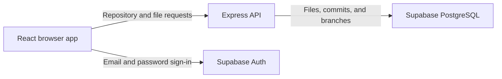

# GitTogether

GitTogether is a code editor and version control system that runs in the browser. You can sign in, create a repository, edit files, and save your work as commits. You can also create branches, switch between them, and browse each branch’s commit history.

## Architecture

## How version control works

GitTogether stores the current working files and the commit history separately in PostgreSQL. When you commit, the backend saves a snapshot of the current files and links the new commit to its parent. Each branch keeps track of its latest commit. When you switch branches, the backend loads that branch’s latest snapshot back into the editor.

For example, you can commit a working version on `main`, create a branch to try a change, and commit it there. Switching back to `main` restores the files from the last commit on `main`.

## Code and setup

- [`frontend/`](frontend/) contains the React and TypeScript editor, file browser, and history view. It runs with Vite.
- [`backend/`](backend/) contains the Node.js and Express API for repositories, files, commits, and branches.
- Supabase provides email and password sign-in and hosts the PostgreSQL database.

The [backend](backend/.env.example) and [frontend](frontend/.env.example) environment templates list the settings needed to connect to Supabase. To run the app locally, you’ll need a Supabase project with the base database schema already in place. [`SUPABASE_MIGRATION.sql`](SUPABASE_MIGRATION.sql) adds a column to the existing `commits` table. 
